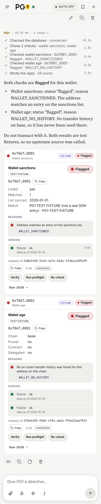
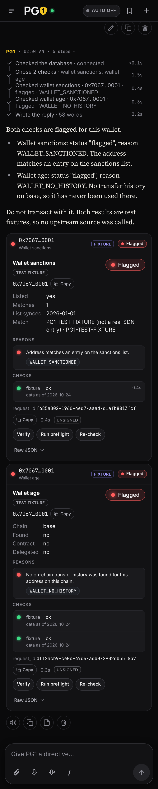
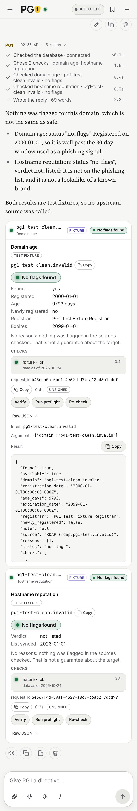
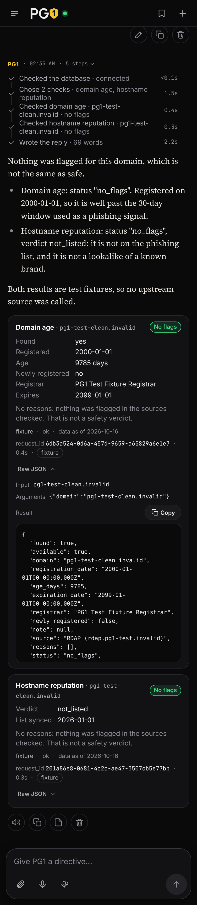

# PG1 Sovereign Threat Intelligence API

Threat intelligence API and MCP server for AI agents and security tooling.

**License keys:** new sales are temporarily paused while data licensing is finalised. The free tier and x402 remain available.

## For agents

<!-- This section is published as the public page /docs/agents (public/docs/agents/index.html): after editing it, run npm run docs:build. Keep it free of repo-relative links. The limits below are pinned to lib/x402Config.mjs and lib/freeTier.mjs by tests/agent-guide.test.mjs. -->

Start with the free point checks. When you want one decision before acting, use `preflight_check`.

### Why agents use PG1

An autonomous agent acts on things it has never seen before: it pays a wallet, opens a link, installs a package, patches a CVE. PG1 checks that thing first and answers in one machine-readable shape, `reasons` + `status` + `checks`, so the agent can decide on its own and a person can audit why.

- **It never says "safe".** PG1 only knows what its sources have recorded, so the best answer it gives is `no_flags`: nothing found in the sources checked. A check that did not finish is `unknown`, never `no_flags`.
- **Free to start.** The wallet, domain, hostname and package checks are always free. The paid calls start with 5 free calls a day; after that each is 0.01 USD in USDC on Base via x402, with no account or key.
- **One call before you act:** `preflight_check` takes the action you are about to take (`pay`, `open`, `install`, `patch`, `trust_agent`) and its target, runs every relevant check in parallel and returns one decision. It fails closed: a check that does not finish makes it `unknown`.
- **Signed results.** Every result carries an Ed25519 signature over the request, the result, its sources, a timestamp and PG1's version; check it offline against [/.well-known/pg1-signing-key](https://pg1-ai-agent.vercel.app/.well-known/pg1-signing-key) or with the free `verify_result` tool.
- **The tools that matter most:** `preflight_check`, `check_wallet_sanctions`, `check_wallet_age`, `check_hostname_reputation`, `check_domain_age`, `check_package`, `get_cve_details`, `get_cve_batch`, `get_threat_actor_profile` and `get_ioc_context`.

Connect in under 30 seconds. Add the MCP server to your client:

```json
{ "mcpServers": { "pg1": { "type": "http", "url": "https://pg1-ai-agent.vercel.app/api/mcp" } } }
```

Or call it directly:

```bash
curl -X POST https://pg1-ai-agent.vercel.app/api/mcp \
  -H "Content-Type: application/json" \
  -H "Accept: application/json, text/event-stream" \
  -d '{"jsonrpc":"2.0","id":1,"method":"tools/call","params":{"name":"check_hostname_reputation","arguments":{"hostname":"example.com"}}}'
```

A2A agents use `https://pg1-ai-agent.vercel.app/api/a2a` (agent card at `/.well-known/agent-card.json`).

### Which tool to call

| You have | Call | Notes |
|---|---|---|
| An action you are about to take (pay, open, install, patch, trust an agent) | `preflight_check` | Start here when you want one decision. 0.01 USD per call, 5 free calls a day (shared with the other paid tools). Runs the checks below in parallel and returns one decision: `no_flags` (no flags found), `flagged` or `unknown`. Fail closed: a check that does not finish makes the decision `unknown`, never `no_flags`. |
| An x402 endpoint you are about to pay | `check_x402_endpoint` | Reads its 402 payment request: payTo sanctions and wallet age, network and asset sanity, TLS, domain age. |
| Another agent you are about to trust | `check_agent_card` | Fetches its A2A agent card: schema validity, domain age and reputation, look-alike names. |
| Where to host a workload (privacy, residency, latency, uptime, budget) | `hosting_advisor` | Ranked regions and providers with cited reasons, a redundancy plan and privacy-by-design guidance. Paid; not legal advice. REST: `POST /api/hosting-advisor`. |
| A PG1 result and its signature | `verify_result` | Checks the Ed25519 signature against PG1's published keys. Always free. |
| One IP, domain, URL or file hash | `get_ioc_context` | Free when nothing is on record (`found: false`). PG1's licensed records hold only CVE ids from NVD today, so an IP, domain, URL or hash returns `found: false`; for a domain or hostname also run the two hostname checks below. |
| Several indicators (up to 20) | `get_ioc_batch` | Free when none is found (the same CVE-only records as above). Read each entry in `results`, not only the batch `status`. |
| A CVE id | `get_cve_details` | Several ids: `get_cve_batch` (up to 20). |
| A vendor and product, no CVE id | `get_cve_by_product` | Known-exploited CVEs come first. |
| A wallet address you are about to pay or trust | `check_wallet_sanctions` **and** `check_wallet_age` | Sanctions list match, then on-chain age; a wallet with no history is flagged. |
| A link, hostname or possible phishing site | `check_hostname_reputation` **and** `check_domain_age` | Listed or look-alike hostname, then registration age; a domain under 30 days old is flagged. |
| An npm or PyPI package before installing it | `check_package` | Flags a name that does not exist, a malicious report, or a new look-alike of a popular package. |
| A threat actor or APT name | `get_threat_actor_profile` | MITRE ATT&CK dossier. |
| One public IP and your own AbuseIPDB key | `check_ip_abuse` | Send the key in `X-AbuseIPDB-Key`; PG1 has no key of its own. |
| The CVE list to ingest | `get_threat_indicators` | STIX 2.1 bundle of CVE records from NVD: CVE id and an NVD reference, no scores, no IP/domain/URL/hash indicators. REST: `GET /api/ioc`. Free while it holds no current data (`PG1_FEED_PAID` off): no payment, no licence key, and it does not use the 5 free calls a day. |
| Your remaining free calls | `get_usage_status` | Always free. |
| An indicator you observed and want to report | `submit_indicator` | Licence key only (`X-API-KEY`); not sold per call. Submissions are reviewed before use. |

### One `preflight_check`, three actions

Each call returns one `decision`. These targets are PG1's test fixtures ([/docs/testing](https://pg1-ai-agent.vercel.app/docs/testing)), so the checks inside make no upstream lookup and the answers are fixed; each `preflight_check` call still counts against the 5 free calls a day.

```json
{"action":"open","target":"https://pg1-test-flagged.invalid/login"}
{"action":"pay","target":"0x7067312d746573742d6669787475726500000002"}
{"action":"install","target":"_pg1-test-unknown","ecosystem":"npm"}
```

| Action | Checks run | `decision` | Why |
|---|---|---|---|
| `open` + URL | `check_hostname_reputation`, `check_domain_age` | `flagged` | `HOSTNAME_PHISHING_LISTED` and `DOMAIN_NEWLY_REGISTERED_30D` |
| `pay` + wallet | `check_wallet_sanctions`, `check_wallet_age` | `no_flags` | No flags found in the sources checked. It is not a verdict that the wallet is safe. |
| `install` + package | `check_package` | `unknown` | The package lookups did not complete, so the decision fails closed. Stop or ask a person. |

### What `status` means

| `status` | Meaning | What to do |
|---|---|---|
| `"no_flags"` | No flags found **in the sources checked** (see `checks`). PG1 never calls a target "safe". | Proceed under your own policy. |
| `"flagged"` | At least one warning in `reasons`. | Stop, or escalate to a person. Match on `reasons[].code`, never on `message`. |
| `"unknown"` | A source timed out, errored or was skipped, so the answer is incomplete. | Never treat it as clean: retry, or fail closed. |

Informational codes (`WALLET_DELEGATED`, `IP_TOR_EXIT_NODE`, `IP_WHITELISTED`, `IP_REPORTS_SCORED_ZERO`) report a fact and never change `status`. Every code: [/docs/reason-codes](https://pg1-ai-agent.vercel.app/docs/reason-codes).

### Verify a result

Every PG1 result is signed with Ed25519, so an agent can prove later, offline, that PG1 said it:

- **Where:** MCP `result._meta["pg1/signature"]`, A2A the task's `metadata["pg1.signature"]`, REST (`/api/preflight`) the top-level `signature`.
- **What is signed:** the canonical JSON (keys sorted, no spaces) of `{ request_hash, result, sources, timestamp, version }`. `request_hash` is the SHA-256 of the canonical `{ tool, arguments }` you sent, so a signature cannot be moved to another request; `sources` is the result's `checks[].source` list.
- **The block:** `{ alg: "EdDSA", kid, request_hash, sources, timestamp, version, sig }`, `sig` base64url.
- **Keys:** [/.well-known/pg1-signing-key](https://pg1-ai-agent.vercel.app/.well-known/pg1-signing-key) (a JWKS; pick the key by `kid`). Old keys stay listed after a rotation, so old signatures keep verifying.
- **How:** the free `verify_result` tool, or offline with the PG1 SDKs (`verifyResult` in JavaScript, `verify_result` in Python): rebuild the canonical payload from the result without its `signature` field and check `sig` with the key.

Watchlist webhooks are signed separately with HMAC-SHA256: `X-PG1-Signature: t=<unix>,v1=<hex HMAC(secret, "<t>.<body>")>`; reject a delivery older than 5 minutes.

### Free tier and rate limits

| Tool | Cost | Limit without a licence key |
|---|---|---|
| `check_wallet_sanctions` | Always free | 120 calls/hour per caller |
| `check_domain_age`, `check_hostname_reputation`, `check_wallet_age`, `check_package` | Always free | 60 calls/hour per caller, per tool |
| `check_ip_abuse` | Always free (your own AbuseIPDB quota) | 60 calls/hour per caller |
| `check_x402_endpoint`, `check_agent_card` | Always free | 60 calls/hour per caller, per tool |
| `verify_result` | Always free | none |
| `preflight_check`, `hosting_advisor` | Paid: 0.01 USD per call | 5 free calls a day per caller, shared with the other paid tools, then x402 |
| `get_usage_status` | Always free | none |
| `get_ioc_context`, `get_ioc_batch` | Free when nothing is found; paid when something is | Paid calls use the free tier first |
| `get_threat_indicators`, `GET /api/ioc` (the STIX feed) | Free while the feed holds no current data (`PG1_FEED_PAID` off) | none, and it does not use the 5 free calls a day |
| `get_cve_details`, `get_cve_batch`, `get_cve_by_product`, `get_threat_actor_profile` | Paid: 0.01 USD per call | 5 free calls a day per caller, shared across all of them, then x402 |
| `submit_indicator` | Licence key only (no x402, no free tier) | none |
| Test fixtures ([/docs/testing](https://pg1-ai-agent.vercel.app/docs/testing)) | Always free | none, and they spend no free call |

- **No header is needed for the free tier.** It is automatic for any caller with no payment and no licence key. Responses carry `X-Free-Tier-Limit` and `X-Free-Tier-Remaining`.
- Send `X-Free-Tier: 0` to skip it and get the payment challenge straight away.
- A licence key in `X-API-KEY` lifts the hourly limits and pays for paid calls.
- A rate-limited call is a `rate_limited` error with `retry_after`.

## Two Ways to Connect

- **`/api/ioc`** — simple REST GET, returns a STIX 2.1 bundle of CVE records from NIST NVD (the only source PG1 may currently redistribute commercially; no IP, domain, URL or file-hash indicators yet). Free while it holds no current data: no key, no payment, no free-tier use. Best for scripts, curl, and simple integrations.
- **`/api/mcp`** — full Model Context Protocol server, 20 tools (one-call preflight, a hosting advisor, CVE lookups, batch operations, threat actor dossiers, wallet sanctions screening, domain age, hostname/phishing reputation, wallet age/history, and more). Best for Claude, MCP-compatible agents, and any client speaking the MCP standard.

**Discovery:** [`/llms.txt`](https://pg1-ai-agent.vercel.app/llms.txt) (llmstxt.org format, for AI agents/crawlers) and [`/openapi.json`](https://pg1-ai-agent.vercel.app/openapi.json) (OpenAPI 3.1 spec for `/api/ioc` and `/api/health`).

**Opt-in:** `/api/ioc/context?value=<indicator>` — a REST mirror of the `get_ioc_context` MCP tool, disabled by default. The operator must set `ENABLE_REST_IOC_CONTEXT=true` for this route to respond; otherwise it returns `404 {"error":"not available"}`. Not listed in x402 Bazaar/discovery metadata.

Paid MCP tools accept a Gumroad license key via the `x-api-key` header, or per-call x402 micropayments ($0.01/call) via the `PAYMENT-SIGNATURE` header (x402 v2). `/api/ioc` takes the same when the operator makes the feed paid again (`PG1_FEED_PAID=true`).

## Free Tier (5 calls/day)

The free tier is **automatic**: a caller with no licence key and no payment gets **5 free paid calls a day** before the first `402 Payment Required`. No header or sign-up is needed, so a browser or an MCP client's first calls just work.

It is **one counter per caller (a salted hash of the IP, never the IP itself), shared** by the paid MCP tools (`/api/mcp`) and the paid A2A skills (`/api/a2a`): 5 free paid calls a day in total, whichever route spends them. A call only counts once it succeeds; `HEAD` never counts. Each free-tier response carries `X-Free-Tier-Limit` and `X-Free-Tier-Remaining`, and `get_usage_status` shows what is left. A caller offering a payment is always charged, never served free. Send `X-Free-Tier: 0` to skip the free tier and get the payment challenge straight away. Requests whose User-Agent names an x402 scanner, crawler or bot (`config/usageProbes.mjs`) skip it too, so discovery scanners still see the 402 they list paid resources by.

**The STIX feed is free while it holds no current data.** `get_threat_indicators` and `GET /api/ioc` are served to anyone: no 402, no licence key, and they do not count against the 5 calls a day, even with `X-Free-Tier: 0` or a payment header (nothing is charged). The operator sets `PG1_FEED_PAID=true` to make the feed paid again once the pipeline fetches recent CVEs; it then uses the free tier and x402 like the other paid tools.

```bash
curl "https://pg1-ai-agent.vercel.app/api/ioc"
```

Optional query parameters: `?since=<ISO timestamp>`, `?type=<IPv4|domain|URL|FileHash-MD5|FileHash-SHA1|FileHash-SHA256>`, `?min_score=<0-100>`, `?limit=<1-1000>`

**Note on confidence scores:** indicator `confidence` currently defaults to a fixed value of 50 whenever the source record has no `confidence_score` — it is not yet a computed/weighted score for those records.

**Exception:** `get_ioc_context` and `get_ioc_batch` (the pre-action safety-check tools) are always free when the result is `found: false` — no `x-free-tier` header needed for those specific "nothing on record" responses. The header is only required for the general free tier.

## Paying for MCP Tool Calls (x402 v2)

`/api/mcp` follows the [x402 v2 MCP transport spec](https://github.com/coinbase/x402) for paid `tools/call` requests, so a payment can be attached either as an MCP-native field or as an HTTP header — whichever your client library supports:

1. **`params._meta["x402/payment"]`** (recommended for MCP clients, e.g. `@x402/mcp`) — attach the signed x402 v2 `PaymentPayload` object directly to the JSON-RPC request:

   ```jsonc
   {
     "jsonrpc": "2.0",
     "id": 1,
     "method": "tools/call",
     "params": {
       "name": "get_cve_details",
       "arguments": { "cve_id": "CVE-2021-44228" },
       "_meta": { "x402/payment": { "x402Version": 2, "scheme": "exact", "network": "eip155:8453", "accepted": { /* … */ }, "payload": { /* … */ } } }
     }
   }
   ```

2. **`PAYMENT-SIGNATURE` header** (or `X-Payment`) — the same signed payload, base64-encoded, attached at the HTTP transport level instead of inside the JSON-RPC request. This is how non-MCP-aware HTTP clients pay.

If both are present on the same request, `_meta` wins.

**Unpaid calls don't get an HTTP 402.** A `tools/call` for a paid tool with no license key, no free tier, and no payment returns a normal `200 OK` JSON-RPC result shaped as an MCP tool error:

```jsonc
{
  "jsonrpc": "2.0",
  "id": 1,
  "result": {
    "isError": true,
    "structuredContent": { "x402Version": 2, "error": "Payment required", "resource": { /* … */ }, "accepts": [ /* … */ ] },
    "content": [{ "type": "text", "text": "{\"x402Version\":2,...}" }]
  }
}
```

The same object is also sent, base64-encoded, in the `PAYMENT-REQUIRED` response header for backward compatibility with clients that only read headers. A verification or settlement failure returns this exact same shape (still `200 OK`, `isError: true`), with `structuredContent.error` describing what went wrong.

On a successful payment, the tool result carries the facilitator's settlement receipt in `result._meta["x402/payment-response"]`, and the `PAYMENT-RESPONSE` header is set as before.

## Installation & Connection (MCP Clients)

To connect your autonomous agent to the PG1 API, pass your Gumroad license key in the connection request.

### Option 1: Via Smithery CLI

Run this command in your terminal, replacing the placeholder with your active key:

```bash
smithery mcp add --transport http --id pg1-threat-intel https://pg1-ai-agent.vercel.app/api/mcp --header "x-api-key: YOUR_GUMROAD_LICENSE_KEY"
```

### Option 2: Free-tier test via curl (no key needed)

```bash
curl -X POST https://pg1-ai-agent.vercel.app/api/mcp \
  -H "Content-Type: application/json" \
  -H "Accept: application/json, text/event-stream" \
  -d '{
    "jsonrpc": "2.0",
    "id": 1,
    "method": "tools/call",
    "params": {
      "name": "get_cve_details",
      "arguments": { "cve_id": "CVE-2021-44228" }
    }
  }'
```

## All Available MCP Tools

Call `"method": "tools/list"` against `/api/mcp` for full schemas. Summary:

| Tool | Purpose | Source(s) | Free tier applies? |
|---|---|---|---|
| `preflight_check` | One call before an agent pays, opens, installs, patches or trusts another agent: every relevant check in parallel, one decision (`no_flags`, `flagged`, `unknown`), fail closed | PG1's own checks below | Yes (5 free calls/day, then x402). REST: `POST /api/preflight` |
| `check_x402_endpoint` | Check an x402 endpoint before paying it: payTo sanctions and wallet age, network and asset, TLS, domain age | The checks below, live | Always free (60 calls/hour without a licence key) |
| `check_agent_card` | Check another agent before trusting it: A2A card schema, domain age and reputation, look-alike names | The checks below, live | Always free (60 calls/hour without a licence key) |
| `verify_result` | Verify a PG1 result's Ed25519 signature against the published keys | `/.well-known/pg1-signing-key` | Always free |
| `hosting_advisor` | Ranked hosting regions and providers with cited legal, privacy and latency reasons; not legal advice | PG1's curated, cited dataset | Yes (5 free calls/day, then x402). REST: `POST /api/hosting-advisor` |
| `get_threat_indicators` | STIX 2.1 bundle of CVE records (CVE id and NVD reference; no IP/domain/URL/hash indicators yet) | NVD (only sources PG1 may redistribute commercially; see [Data source switches](#data-source-switches)) | No: free while the feed holds no current data (`PG1_FEED_PAID`) |
| `get_ioc_context` | Single-indicator safety check | NVD (see [Data source switches](#data-source-switches)) | Always free if not found |
| `get_ioc_batch` | Up to 20 indicators per call | NVD (see [Data source switches](#data-source-switches)) | Always free if none found |
| `get_cve_details` | CVE lookup enriched with NVD, CISA KEV (EPSS only when `PG1_SOURCE_EPSS_PAID` is on) | NVD, CISA KEV | Yes (5 free calls/day, then x402) |
| `get_cve_batch` | Up to 20 CVE IDs per call | NVD, CISA KEV (EPSS as above) | Yes (5 free calls/day, then x402) |
| `get_cve_by_product` | Discover CVEs by vendor/product | NVD | Yes (5 free calls/day, then x402) |
| `get_threat_actor_profile` | APT/threat actor dossiers with MITRE ATT&CK | MITRE ATT&CK Enterprise | Yes (5 free calls/day, then x402) |
| `get_usage_status` | Check your remaining free-tier quota | — | Always free, no header needed |
| `submit_indicator` | Contribute an observed indicator for review | — | No — license key required |
| `check_wallet_sanctions` | Screen a wallet address against sanctions | OFAC SDN List (US Treasury), synced daily | Always free (120 calls/hour without a licence key) |
| `check_domain_age` | Domain registration age via RDAP | RDAP (per-TLD server, resolved via the IANA bootstrap registry) | Always free |
| `check_hostname_reputation` | Screen a hostname for phishing/lookalike domains | MetaMask eth-phishing-detect, synced daily | Always free (60 calls/hour without a licence key) |
| `check_wallet_age` | When an EVM address first appeared on a chain, via on-chain transfer history | On-chain transfer history (per-chain) | Always free (60 calls/hour without a licence key) |
| `check_ip_abuse` | Abuse confidence score and report counts for one public IP, with **your own** AbuseIPDB key | AbuseIPDB, live, with the key you send in `X-AbuseIPDB-Key` | No PG1 charge; uses your own AbuseIPDB quota (60 calls/hour without a licence key). See [Bring your own AbuseIPDB key](#bring-your-own-abuseipdb-key) |
| `check_package` | Check before you install: one npm or PyPI package (exists?, age, reported malicious, known vulnerabilities, look-alike name, npm deprecation and install scripts) | npm public registry / PyPI, and OSV.dev (OpenSSF Malicious Packages, GitHub Advisory Database, PyPI Advisory Database); see [/docs/attributions](https://pg1-ai-agent.vercel.app/docs/attributions) | Always free (60 calls/hour without a licence key). See [Check a package before you install it](#check-a-package-before-you-install-it) |

`subscribe_alerts` is **Not available** (not in `tools/list`; a call returns `not_available`, free). For alerts use a watchlist: `POST /api/watchlists`, 0.05 USD per item for 30 days via x402, signed webhook on every status change.

### Important wording caveats

- **`check_wallet_sanctions`**: a `listed: false` result means the address is not on the OFAC SDN list as of the reported `list_last_synced` time. It is **informational only, not legal or sanctions-compliance advice**, and is never phrased as "safe" or "clean". If the sanctions data is empty or unreachable, the tool returns an error instead of a false `listed: false`. **Address validation:** the tool queries `public.sanctioned_wallets` for the (normalised) address *first* — a match always returns `listed: true`, even if the address doesn't fit a currently-recognised format. Only when there is **no match** does the tool fall back to a format check: if `address` does not match a recognised format for any currency in the sanctions list (EVM `0x` + 40 hex; BTC/LTC/BCH/DOGE/DASH/ZEC base58 or bech32/CashAddr; TRON; Monero; Solana base58), it returns an MCP tool error (`isError: true`, `code: "invalid_address"`) instead of `listed: false` — this applies to malformed input like `"hello"` or a `0x` address of the wrong length. An empty `address` is always rejected as `invalid_address` before any lookup. It is free and, without a Gumroad license key, limited to 120 calls/hour per caller (per IP, one counter across `/api/mcp` and `/api/a2a`); the 121st call in the hour gets the same `rate_limited` tool error as `check_wallet_age`, and fixture inputs never count.
- **`check_domain_age`**: a newly registered domain (`age_days < 30`) is reported as **a common phishing signal, not proof of malicious intent**. On a successful lookup the tool returns `found: true` (and, for backward compatibility, `available: true` — **`available` is deprecated, prefer `found`**). When the lookup does not resolve it returns `found: false` / `available: false` with a `reason` and a `reason_code`: `"unsupported_tld"` when the TLD has no RDAP server in the IANA bootstrap registry, `"timeout"` when the RDAP lookup times out, `"invalid_domain"`/`"bootstrap_unavailable"`/`"lookup_failed"` for other failure modes. It never guesses an age and never falls back to WHOIS.
- **`get_ioc_context` / `get_ioc_batch`** (existing behavior): a `found: false` result means nothing bad is recorded in PG1's sources — it does **not** mean the indicator is safe, only that it isn't in this dataset.
- **`check_hostname_reputation`**: takes a single bare hostname (no bulk input, no URL/scheme/path/port/wildcards) and screens it — plus every parent domain — against `public.phishing_domains` (blocklist/allowlist/fuzzylist, synced daily by the sovereign-threat-pipeline repo) and `public.phishing_list_meta`. Returns `verdict: "allowlisted" | "listed" | "lookalike" | "not_listed"` — **never** `"safe"` or `"clean"`. An allowlist match always wins over a blocklist match. A `"listed"` verdict reports `match_type: "exact"` or `"parent_domain"`. A `"lookalike"` verdict means the hostname wasn't directly listed but resembles a known brand domain from the fuzzylist — either a confusable-character/typo skeleton within the stored tolerance (default 3), or a brand keyword (min. 5 chars) embedded alongside other words (e.g. `metamask-login.com`) — and sets `lookalike_of` to the matched brand domain; the brand's own real domain and its subdomains are never flagged. If the phishing list data is unreachable or times out, the tool returns an error rather than ever reporting `not_listed`. Malformed hostname input returns an MCP tool error (`isError: true`, `code: "invalid_hostname"`). List contents are never exposed beyond the single matched entry. It is free and, without a Gumroad license key, limited to 60 calls/hour per caller; a license key (`X-API-KEY`) bypasses this limit.
- **`check_wallet_age`**: reports when an EVM address (`0x` + 40 hex, case-insensitive) first appeared on a given chain (`base` by default, or `ethereum`/`arbitrum`/`optimism`/`polygon`/`bsc`), based on the earliest of its on-chain transfers in or out, plus whether it's a contract (`is_contract`). **Age is per chain**: `first_seen`/`age_days` describe this address's history on the requested `chain` only, so the same address can be old on one chain and brand-new (or `found: false`) on another — check each chain you care about. A `found: false` result (all other fields `null` except `is_contract`) means the address has no transfer history on that chain — a normal, common result, **not an error**, and **not evidence the address is safe or unsafe either way**; this tool reports age and history only. An upstream failure or timeout returns an MCP tool error (`isError: true`, `code: "upstream_unavailable"`) rather than ever falling back to `found: false`, since a data-source outage must never be read as "brand-new wallet". Malformed `address`/`chain` input returns an MCP tool error (`code: "invalid_address"` / `"invalid_chain"`). A found result is cached permanently; a `found: false` result is cached for 10 minutes only. It is free and, without a Gumroad license key, limited to 60 calls/hour per caller, same as `check_domain_age` / `check_hostname_reputation`. Since 1.14.0, cached answers count against that limit too, because each one still makes a live delegation check; a licence key still exempts the caller.
  - **EIP-7702 delegation (`delegated`, `delegate_address`)**, added in 1.14.0 as optional fields: `delegated: true` when the address's code on the requested chain is exactly 23 bytes, `0xef0100` followed by a 20-byte delegate address (an [EIP-7702](https://eips.ethereum.org/EIPS/eip-7702) delegation), with that address, lowercased, in `delegate_address`. `delegated: false` (and `delegate_address: null`) when the code is anything else: empty, an ordinary contract, or something that only looks like the prefix at the wrong length. `delegated: null` means the code check did not complete (timeout or upstream error). It is never guessed as `false`; the age result is still returned, and `status` is `"unknown"`. The delegation check always has its own `checks` entry, `source: "on-chain code"`, with `result` `"ok"`, `"error"` or `"timeout"`, so you can see whether it completed. Delegation is **never cached**: the owner can add or remove it at any time, so it is checked live on every call, cached age answers included, while `first_seen` stays cached as before. A delegated address gets reason code `WALLET_DELEGATED`, which states the fact only, not a judgement. It is informational and **never changes `status` on its own**: an old delegated wallet is `status: "no_flags"` with `reasons: [WALLET_DELEGATED]`, the same status as an old non-delegated wallet (`"no_flags"`, `reasons: []`). `status` is only ever what it would have been without the delegation, or `"unknown"` when the code check didn't complete. Examples: an old wallet with a partial lookup (`WALLET_AGE_PARTIAL`) is `"unknown"`, delegated or not, and a no-history wallet is `"flagged"` whatever its delegation state. `is_contract` has not changed and is still `true` for a delegated address, so existing integrations behave as before. Delegation is per chain too: a delegation on one chain says nothing about another.
- **`check_package`**: never "safe" or "clean". A malicious-package report is always worded **"reported malicious"**: the source has false positives. A failed registry lookup gives `exists: null` (never `false`) and `status: "unknown"`. See [Check a package before you install it](#check-a-package-before-you-install-it).
- **`check_wallet_sanctions` / `check_domain_age` / `check_hostname_reputation` / `check_wallet_age`** all declare an `outputSchema` and return a matching `structuredContent` object alongside the existing `content` text block, per the MCP spec — clients that support structured tool output can read fields directly instead of parsing the text block.

### Data source switches

Threat indicator data (`get_threat_indicators`, `get_ioc_context`, `get_ioc_batch`, `/api/ioc`, `/api/ioc/context`, and the chat and playground checks built on them) is filtered by upstream source in one place, `lib/sourcePolicy.mjs`, on every query. These are paid responses, so a source is served only when PG1 may resell it: our own data, public-domain data, or a source whose terms explicitly allow commercial resale.

| Variable | Default | Covers |
|---|---|---|
| `SOURCE_ABUSECH_ENABLED` | **always off** (locked; the variable is ignored) | abuse.ch (ThreatFox, URLhaus, MalwareBazaar, Feodo, SSLBL, YARAify). Not served in the paid API until licensed. |
| `SOURCE_OTX_ENABLED` | **always off** (locked) | AlienVault OTX. No commercial licence. |
| `SOURCE_ABUSEIPDB_ENABLED` | **always off** (locked) | AbuseIPDB-labelled rows. PG1 declined AbuseIPDB's licence; `check_ip_abuse` only ever uses the caller's own key. |
| `SOURCE_UNATTRIBUTED_ENABLED` | **always off** (locked) | Rows with no source label, and rows from the old pipeline labelled `Sovereign-Engine-v3.2-*`, which hide the real feed. No recorded source means unlicensed. |
| `SOURCE_NVD_ENABLED` | on | NIST NVD (US Government work, public domain). |
| `SOURCE_BLOCKLIST_DE_ENABLED`, `SOURCE_PG1_SWARM_ENABLED`, `SOURCE_SCAMSNIFFER_ENABLED`, `SOURCE_OTHER_ENABLED` | **off** | Blocklist.de, `PG1-Swarm-*` labels, ScamSniffer, and any other label. Off until their terms are confirmed for commercial resale; set to `true` only once they are. |

A locked source can only be served again by a code change, made once a licence is signed.

**EPSS in paid CVE responses.** FIRST grants EPSS scores "freely to the public" but has not confirmed resale in writing, so paid CVE responses (`get_cve_details`, `get_cve_batch`, `get_cve_by_product` over MCP or A2A, whether paid by x402, a licence key or the free tier) leave EPSS out and never call FIRST for it: no `epss` field, no EPSS check, no EPSS credit. `PG1_SOURCE_EPSS_PAID=true` puts it back; set it only once FIRST confirms resale in writing. Free responses (the PG1 chat) keep EPSS.

**The STIX feed's price.** `get_threat_indicators` and `/api/ioc` are free while the feed holds no current data. `PG1_FEED_PAID=true` makes them paid again (0.01 USD a call, the shared free tier first); at the same time add `/api/ioc` back to `public/.well-known/x402` and `x-payment-info` to its two operations in `public/openapi.json` (`node scripts/verify-payment-config.mjs` checks this).

**Licence keys are never stored.** `api_access_logs` records a licence-key caller as `license:<HMAC>` (salted with `TELEMETRY_IP_SALT`, domain-separated from the IP hash), a free-tier caller as `free-tier:<IP hash>`, and the free feed as `free-feed`; a database check constraint rejects anything else.

**`threat_indicators`.** The legacy `threat_indicators` table (rows with no `source_id` and nothing in `stix_data`) is never read by a paid route; only the operator's own chat context and the operator-only diagnostics endpoint read it. `tests/phase2-funnel.test.mjs` pins both.

A switched-off source's rows never appear in any response, paid or free; an indicator known only to such a source is reported as `found: false`.

## A2A (Agent2Agent Protocol)

`/api/a2a` exposes ten always-free skills (`check_wallet_sanctions`, `check_domain_age`, `check_hostname_reputation`, `check_wallet_age`, `check_package`, `check_x402_endpoint`, `check_agent_card`, `verify_result`, `get_usage_status`, and `check_ip_abuse`, which needs your own key in the `X-AbuseIPDB-Key` header exactly as on `/api/mcp`) over [A2A](https://a2a-protocol.org/latest/specification/), JSON-RPC 2.0, plus six **paid skills**: `preflight_check`, `hosting_advisor`, `get_cve_details`, `get_cve_batch`, `get_cve_by_product` and `get_threat_actor_profile` (0.01 USD a call), paid jobs (`submit_job`) and commissioned tools (`build_tool`). A paid skill is served free while the caller has free calls left (the shared 5/day counter above, automatic), and after that with a licence key (`X-API-KEY`) or an x402 payment. Payment follows the [a2a-x402 extension](https://github.com/google-agentic-commerce/a2a-x402/blob/main/spec/v0.1): an unpaid call returns a task in state `input-required` whose status message metadata carries `"x402.payment.status": "payment-required"` and the x402 v2 PaymentRequired object in `"x402.payment.required"`; resend the message with the signed PaymentPayload in `message.metadata["x402.payment.payload"]`. The payment is settled only after the skill succeeds, and the receipt comes back in `"x402.payment.receipts"`. The NVD CVE feed and the record lookups stay on `/api/mcp`. The agent card is published at [`/.well-known/agent-card.json`](https://pg1-ai-agent.vercel.app/.well-known/agent-card.json). `message/send` (the v0.3 method name) is accepted as an alias of `SendMessage`. The `A2A-Version` header (or query param) selects the response shape — `1.0` or `0.3` (the default when omitted). Rate limits are the MCP tools' own, with the same counters: for example, without a licence key `check_wallet_sanctions` is limited to 120 calls/hour per caller (per IP), and the 121st call in the hour gets the same `rate_limited` error as `check_wallet_age`. Send the skill and its arguments as a `DataPart`:

```bash
curl -X POST https://pg1-ai-agent.vercel.app/api/a2a \
  -H "Content-Type: application/json" \
  -H "A2A-Version: 1.0" \
  -d '{
    "jsonrpc": "2.0",
    "id": 1,
    "method": "SendMessage",
    "params": {
      "message": {
        "role": "user",
        "messageId": "1",
        "parts": [{ "kind": "data", "data": { "skill": "check_domain_age", "arguments": { "domain": "example.com" } } }]
      }
    }
  }'
```

## Bring your own AbuseIPDB key

`check_ip_abuse` (MCP tool and A2A skill, since 1.16.0) looks up one public IPv4 or IPv6 address in [AbuseIPDB](https://www.abuseipdb.com) using **your own** AbuseIPDB API key, free or paid. It runs under an agreement with AbuseIPDB, on these terms:

- **Your key only.** Send it in the `X-AbuseIPDB-Key` HTTP request header on `/api/mcp` or `/api/a2a`. It is never a tool argument (arguments end up in model context and logs). PG1 has no AbuseIPDB key of its own and never falls back to one: no header, no AbuseIPDB call, and the tool returns `isError: true` with code `abuseipdb_key_required`.
- **Your results only**, always with attribution: every result carries `attribution: { "text": "Data from AbuseIPDB", "url": "https://www.abuseipdb.com/check/<ip>" }`.
- **Cached per key only**: in memory for 15 minutes, keyed by `sha256(your key) + ip + max_age_in_days`. Never stored in a database, never served to anyone else. Raw keys are never stored, logged or returned.
- **Never shared**: results never go into PG1's feed, `get_ioc_context`, `get_threat_indicators` or the pipeline.
- **No PG1 charge** (no x402 payment); lookups count against your own AbuseIPDB quota. PG1's usual limit applies on top: 60 calls/hour per caller without a Gumroad licence key.

Get a key from your AbuseIPDB account: <https://www.abuseipdb.com/account/api>.

```bash
curl -X POST https://pg1-ai-agent.vercel.app/api/mcp \
  -H "Content-Type: application/json" \
  -H "Accept: application/json, text/event-stream" \
  -H "X-AbuseIPDB-Key: $ABUSEIPDB_KEY" \
  -d '{"jsonrpc":"2.0","id":1,"method":"tools/call","params":{"name":"check_ip_abuse","arguments":{"ip":"8.8.8.8","max_age_in_days":90}}}'
```

The same call over A2A:

```bash
curl -X POST "https://pg1-ai-agent.vercel.app/api/a2a?A2A-Version=1.0" \
  -H "Content-Type: application/json" \
  -H "X-AbuseIPDB-Key: $ABUSEIPDB_KEY" \
  -d '{"jsonrpc":"2.0","id":1,"method":"SendMessage","params":{"message":{"messageId":"abuse-1","role":"ROLE_USER","parts":[{"data":{"skill":"check_ip_abuse","arguments":{"ip":"8.8.8.8"}}}]}}}'
```

**Arguments:** `ip` (required, exactly one public IPv4 or IPv6 address; private, reserved, documentation and malformed input is rejected as `invalid_ip` without calling AbuseIPDB) and `max_age_in_days` (optional, 1 to 365, default 90).

**Result** (also as `structuredContent`; the tool declares an `outputSchema`): `ip`, `ip_version`, `max_age_in_days`, `abuse_confidence_score` (0-100), `total_reports`, `distinct_reporters`, `last_reported_at`, `country_code`, `usage_type`, `isp`, `domain`, `is_tor`, `is_whitelisted`, `cached`, `note`, `attribution`, plus the usual `reasons`, `status`, `checks` and `request_id`. `status` follows AbuseIPDB's own judgement of the reports, with no PG1 score threshold on top (choose your own on `abuse_confidence_score`):

| Upstream answer | `status` | Reason |
|---|---|---|
| `is_whitelisted` true (whatever the score or report count) | `"no_flags"` | `IP_WHITELISTED` (informational): AbuseIPDB marks the address as whitelisted and does not count its reports against it |
| Not whitelisted, `abuse_confidence_score` above 0 | `"flagged"` | `IP_ABUSE_REPORTED`, with the score, report and reporter counts |
| Not whitelisted, score 0, reports in the window | `"no_flags"` | `IP_REPORTS_SCORED_ZERO` (informational): the reports exist, but AbuseIPDB scores them 0 |
| No reports in the window | `"no_flags"` | none |
| Score or report count missing | `"unknown"` | none |

`IP_TOR_EXIT_NODE` is informational and can appear alongside any of these. `abuse_confidence_score` is AbuseIPDB's 0-100 confidence that the address is abusive; a score of 0 is not proof the address is harmless, and PG1 never calls a result "safe" or "clean". `checks[0].data_as_of` is `last_reported_at` when there is a report in the window.

**Errors** (MCP `isError: true` with `code`; A2A JSON-RPC error `-32000` with `error.data.code`):

| Code | When | AbuseIPDB called? |
|---|---|---|
| `abuseipdb_key_required` | No `X-AbuseIPDB-Key` header | No |
| `invalid_abuseipdb_key` | AbuseIPDB answered 401/403, or the header can't be a key (spaces, control characters, over 256 characters) | Only in the first case |
| `abuseipdb_rate_limited` | AbuseIPDB answered 429 (your AbuseIPDB quota). `retry_after` (seconds) and the `Retry-After` response header are passed through when AbuseIPDB sends them | Yes |
| `upstream_unavailable` | AbuseIPDB 5xx, an unreadable answer, or no answer within 5 seconds | Yes |
| `invalid_ip` | Not exactly one public IPv4/IPv6 address | No |
| `invalid_max_age` | `max_age_in_days` not a whole number from 1 to 365 | No |
| `rate_limited` | PG1's 60 calls/hour per caller without a licence key | No |

Browsers: `X-AbuseIPDB-Key` is in the CORS `Access-Control-Allow-Headers` of `/api/mcp` and `/api/a2a` only. The chat and the playground never offer this tool.

## Check a package before you install it

`check_package` (MCP tool, A2A skill, chat tool and playground check, since 1.17.0) is a pre-install check for one npm or PyPI package, built for AI agents that are about to install or recommend one. It is free (60 calls/hour per caller without a licence key) and no AI model is involved.

Arguments: `ecosystem` (`"npm"` or `"pypi"`), `name` (one package; npm names may be scoped, `@scope/name`), and optionally `version` (one exact version; without it the latest version is checked).

Signals, each from a licence-checked public source (full list and licences on [/docs/attributions](https://pg1-ai-agent.vercel.app/docs/attributions)):

| Signal | Fields | Source |
|---|---|---|
| Does the package (and version) exist? | `exists`, `version_exists` | npm public registry / PyPI |
| Age | `first_published`, `age_days`, `latest_version`, `latest_published` | npm public registry / PyPI |
| Reported malicious | `reported_malicious`, `malicious_reports` (`MAL-` ids) | OpenSSF Malicious Packages (Apache-2.0), via OSV.dev |
| Known vulnerabilities for the version | `vulnerabilities` (`id`, `severity`, `cvss_vector` only) | GitHub Advisory Database, PyPI Advisory Database (CC-BY 4.0), via OSV.dev |
| Look-alike of a popular package | `lookalike_of`, `lookalike_pattern` (`separator`, `confusable`, `affix`, `edit_distance`) | PG1's own list of popular names |
| npm only: deprecated, install scripts | `deprecated`, `deprecation_message`, `install_scripts` | npm public registry |

Status follows the usual PG1 rules:

- **`"flagged"`** when the version is reported malicious (`PACKAGE_REPORTED_MALICIOUS`), the package or the requested version does not exist (`PACKAGE_NOT_FOUND`, `PACKAGE_VERSION_NOT_FOUND`), or the package was first published under 30 days ago **and** its name looks like a popular package's (`PACKAGE_NEW_LOOKALIKE`).
- **`"unknown"`** when any lookup did not complete: a failed registry lookup gives `exists: null`, never `false`, and a failed OSV lookup gives `reported_malicious: null`.
- **`"no_flags"`** otherwise. A look-alike name alone, a new package alone, known vulnerabilities, deprecation and install scripts are informational reasons that never flag on their own. Never "safe" or "clean".

Only advisories from the databases listed on /docs/attributions are shown; anything else OSV returns is counted in `vulnerabilities_omitted`. Distribution-specific (for example Ubuntu) data is never used. Registry answers are cached for 1 hour and OSV answers (which carry malicious status) for 15 minutes, per package; lookups use short timeouts and one package per request, never bulk crawling. Inputs are never stored: telemetry records the tool name, outcome, latency and a salted caller hash only.

```bash
curl -X POST https://pg1-ai-agent.vercel.app/api/mcp \
  -H "Content-Type: application/json" \
  -H "Accept: application/json, text/event-stream" \
  -d '{"jsonrpc":"2.0","id":1,"method":"tools/call","params":{"name":"check_package","arguments":{"ecosystem":"npm","name":"lodash","version":"4.17.21"}}}'
```

## Ask PG1 to run a check from chat

The signed-in operator can ask PG1's chat to run the read-only tools above in plain words: "check this wallet 0x…", "how old is this domain", "is this hostname a lookalike", "what do you know about CVE-2021-44228". The chat model is offered the read-only MCP tools as native functions (generated from the same tool list and schemas as `tools/list`, filtered by role), runs up to 5 of them per message (in parallel when independent), and writes the answer from the results. Each call runs the same handler an MCP client gets, never an HTTP request to `/api/mcp`.

- **What it can run:** `check_wallet_sanctions`, `check_domain_age`, `check_hostname_reputation`, `check_wallet_age`, `get_ioc_context`, `get_ioc_batch`, `get_cve_details`, `get_cve_batch`, `get_cve_by_product`, `get_threat_actor_profile`. Never `submit_indicator` (it writes), `get_threat_indicators` (a paid bulk feed, not a check), `get_usage_status` (a caller's own quota) or `check_ip_abuse` (it runs only with the caller's own AbuseIPDB key from a request header; the chat has none, and PG1 has no AbuseIPDB key of its own). Nothing the chat runs writes, pays or changes state.
- **Operator use is free**, like a licence holder: no PG1 rate limit, but every upstream source's own timeout and cache still apply, and each call has a timeout of its own (10 s). Each call is logged with a `request_id`, and an upstream failure or timeout goes to the error log under it, as on MCP. The tool list and limits are a per-role policy (`lib/chatTools.mjs`), so a future guest role gets the free `check_*` tools under the anonymous rate limit.
- **Honest answers:** the reply quotes each result's `status` (`flagged`, `no_flags`, `unknown`) and `reasons`; `no_flags` is never "safe". A check that failed, timed out, or came back `unknown` is named at the end of the reply with its `request_id`, by code, whatever the model wrote. Tool output is untrusted data: text inside a result is reported, never followed.
- **Trace and card:** the live trace shows one row per call ("Checked wallet age · 0x12ab…9f3c · no flags", with how long it took; failures in the error colour). Under the reply, one card per result: tool name in plain words, a status chip, key fields, reasons, checks with `data_as_of`, the `request_id`, and a Raw JSON expander with a copy button (addresses shortened in the title, in full in the expander).
- **Voice:** with spoken replies on, a reply that ran checks speaks a short summary (status and main reason per check), never an address, hash or JSON.
- **Demo without upstream calls:** the fixtures below work from chat too, e.g. "check this wallet 0x7067312d746573742d6669787475726500000001" or "how old is pg1-test-clean.invalid"; the card is marked "fixture".

 
 

## Response Metadata (reasons, status, checks, request_id)

Every MCP tool and every free A2A skill adds four fields alongside its existing output — additive only, nothing existing is renamed or repurposed:

- **`reasons`**: `[{ code, message }]`. Zero or more machine-readable codes from the permanent list below. Empty when nothing is flagged. Codes are only ever added, never removed or renamed.
- **`status`**: `"flagged"` when `reasons` contains a genuine warning code; otherwise `"unknown"` when `reasons` contains an incomplete code or any source needed for the answer timed out, errored, or was skipped (never reported as a false-clean `"no_flags"`); otherwise `"no_flags"`. Two kinds of code are listed in `reasons` but are not warnings. **Informational** codes (`WALLET_DELEGATED`, `IP_TOR_EXIT_NODE`, `IP_WHITELISTED`, `IP_REPORTS_SCORED_ZERO`) report a fact and never affect `status`. **Incomplete** codes (currently only `WALLET_AGE_PARTIAL`) mean a check didn't complete, so they make `status` `"unknown"`, not `"flagged"`. For `check_wallet_age`, that means: `"flagged"` only with `WALLET_NO_HISTORY`; otherwise `"unknown"` if anything didn't complete (`WALLET_AGE_PARTIAL`, or `delegated: null`); otherwise `"no_flags"`. (`submit_indicator` keeps its own pre-existing `status` field, which means a submission lifecycle state, not this honest-status value — it gains `reasons`/`checks`/`request_id` only.)
- **`checks`**: `[{ source, result, checked_at, data_as_of }]` — one entry per data source consulted for this call. `result` is one of `"ok" | "timeout" | "error" | "skipped"`. `source` is always a generic label (e.g. `"sanctions list"`, `"domain registration records"`, `"on-chain transfer history"`) — never a vendor/provider name. `checked_at` is when this request ran the check; `data_as_of` is how current the underlying data is, or `null` when not applicable. For `check_wallet_age`, a cached answer's `"on-chain transfer history"` entry has `data_as_of` set to when that age was originally looked up (a fresh lookup has `null`), and the `"on-chain code"` entry is the live delegation check.
- **`request_id`**: a UUID identifying this exact call, also sent as the `X-Request-Id` response header on `/api/mcp` and `/api/a2a`. It is inside the tool result (and `structuredContent`) or, for a JSON-RPC error, inside `error.data` — never at the top level of the JSON-RPC envelope, which holds only `jsonrpc`, `id` and `result`/`error`. If the call fails and gets written to the server error log, the same `request_id` is attached to that log entry.

`check_wallet_sanctions`, `check_domain_age`, `check_hostname_reputation` and `check_wallet_age` also declare these four as optional properties on their `outputSchema` (never added to `required`, and every other part of their schema is unchanged). They also declare an optional boolean `test_fixture`, which is present (and `true`) only on responses to the fixture inputs described in [Test your integration](#test-your-integration). `check_wallet_age` also declares two optional delegation properties, `delegated` (`boolean | null`) and `delegate_address` (`string | null`), which are not in `required` (see the `check_wallet_age` notes above).

### Reason codes

| Code | Meaning |
|---|---|
| `WALLET_SANCTIONED` | Address matches an entry on the sanctions list. |
| `DOMAIN_NEWLY_REGISTERED_30D` | Domain was registered fewer than 30 days ago. |
| `HOSTNAME_PHISHING_LISTED` | Hostname, or a parent domain of it, is on the phishing blocklist. |
| `HOSTNAME_LOOKALIKE` | Hostname is a probable lookalike/typosquat of a known brand domain. |
| `WALLET_NO_HISTORY` | No on-chain transfer history was found for this address on this chain. |
| `WALLET_AGE_PARTIAL` | Internal transfers were not checked in time; the wallet may be older than shown. *(Incomplete: makes `status` `"unknown"`, not `"flagged"`.)* |
| `CVE_KNOWN_EXPLOITED_KEV` | CVE is on the known exploited vulnerabilities catalog. |
| `IOC_FOUND_IN_THREAT_FEED` | Indicator has at least one matching record in the threat indicator feed. |
| `WALLET_DELEGATED` | Address currently has an EIP-7702 delegation on this chain: its code points to a delegate contract. *(Informational: never changes `status` on its own.)* |
| `IP_ABUSE_REPORTED` | IP address has an abuse confidence score above 0 from reports in the reporting window checked. |
| `IP_TOR_EXIT_NODE` | IP address is a Tor exit node. *(Informational: never changes `status` on its own.)* |
| `IP_WHITELISTED` | IP address is whitelisted by the abuse-report source, which does not count its reports against it. *(Informational: never changes `status` on its own.)* |
| `IP_REPORTS_SCORED_ZERO` | IP address has abuse reports in the reporting window checked, but its abuse confidence score is 0. *(Informational: never changes `status` on its own.)* |

Source of truth: `lib/reasonCodes.mjs`.

**Not yet covered:** the `/api/ioc` REST feed and `/api/ioc/context` don't carry `reasons`/`status`/`checks`/`request_id` yet.

## Test your integration

<!-- This section is published as the public page /docs/testing (public/docs/testing/index.html): after editing it, run npm run docs:build. Keep it free of repo-relative links and provider names. The fixture values, the reasoning behind each, and the table rows below come from lib/fixtures.mjs. -->

Every MCP tool that can flag something has three fixed, made-up fixture inputs that always return the same answer: one **FLAGGED**, one **CLEAN** and one **UNKNOWN**. A few have one more for a second case worth testing: `check_wallet_age` **DELEGATED**, `check_hostname_reputation` **LOOKALIKE** (a typosquat rather than a listed hostname), `check_package` **MISSING** (a package that does not exist, like a name an assistant invented), and `get_ioc_batch` / `get_cve_batch` **MIXED** (one flagged entry and one not, so you can check you read each entry and not only the batch status). Use them to test your integration's happy path, its "flagged" path and its skip/retry path without spending anything or depending on live data.

- **Always free**, for every caller: no licence key, no `x-free-tier` header, no x402 payment, no rate-limit usage. This applies to the paid tools too.
- **Same shape as a real response**: `reasons`, `status`, `checks` and `request_id`, plus `test_fixture: true`. Every `checks[]` entry has `source: "fixture"`. On an error-shaped UNKNOWN, `test_fixture: true` is in `error.data` (JSON-RPC errors) or next to `code` (isError tool results).
- **UNKNOWN is exactly what a real upstream failure returns for that tool**, so you can test your skip path. For `check_wallet_age` that is the `upstream_unavailable` isError result, never `found: false`.
- **For `check_domain_age`, always check `status` before `found`: `found: false` with `status: "unknown"` means the lookup did not complete, not that the domain is new.**
- **Exact values only.** The only normalisation is what the tool already does itself: lowercasing a `0x` address or hostname, uppercasing a CVE id, reducing a domain/URL to its registrable domain. Anything else is treated as a real input, even one character off, so `www.pg1-test-flagged.invalid` is a real hostname lookup.
- **Every value is reserved or synthetic**, so none can belong to a real target: `.invalid` domains (RFC 2606/6761), documentation IP ranges (RFC 5737 `192.0.2.0/24`, `198.51.100.0/24`, `203.0.113.0/24`; RFC 3849 `2001:db8::/32`), `CVE-0000-*` ids (the CVE programme started in 1999) and `0x` addresses that spell `pg1-test-fixture` in hex.
- `check_wallet_age` has no age threshold. Its FLAGGED fixture is a wallet with no history (`found: false`, `WALLET_NO_HISTORY`) and its CLEAN fixture is an old wallet with a fixed `first_seen`. Its DELEGATED fixture is an old wallet with an EIP-7702 delegation: `delegated: true`, a synthetic `delegate_address` (also spelling `pg1-test-fixture` in hex) and reason `WALLET_DELEGATED` with `status: "no_flags"`, because that code is informational. Like a real answer, it has two `checks` entries (transfer history, then the delegation check), both `source: "fixture"` and `result: "ok"`. The other fixtures report `delegated: false`. `chain` is optional and is echoed back; an unsupported chain is still an `invalid_chain` error.

- `check_package` uses names that start with `_`, which neither npm nor PyPI accepts, so a fixture can never be a real package; its live path rejects them as `invalid_package_name`. The same three names work with `"ecosystem": "npm"` or `"pypi"`, make no upstream call, and their data is synthetic (the report id `MAL-0000-0001` can never be issued). `version` is optional and echoed back.
- `check_ip_abuse` uses the documentation IPv4 addresses, which its live path rejects as `invalid_ip` (they are reserved, never public), so a fixture can never become a real lookup. Fixtures are answered before the key check: they need no `X-AbuseIPDB-Key` header and make no upstream call. Their data is synthetic and their `attribution.text` says so. `max_age_in_days` is optional and echoed back.
### Fixture table

| Tool | Fixture | Arguments | Expected result |
|---|---|---|---|
| `check_wallet_sanctions` | FLAGGED | `{"address":"0x7067312d746573742d6669787475726500000001"}` | listed: true, status "flagged", reason WALLET_SANCTIONED |
| `check_wallet_sanctions` | CLEAN | `{"address":"0x7067312d746573742d6669787475726500000002"}` | listed: false, status "no_flags" |
| `check_wallet_sanctions` | UNKNOWN | `{"address":"0x7067312d746573742d6669787475726500000003"}` | HTTP 503, JSON-RPC error -32003 "Sanctions data temporarily unavailable, please retry." |
| `check_domain_age` | FLAGGED | `{"domain":"pg1-test-flagged.invalid"}` | found: true, age_days 3, newly_registered: true, status "flagged", reason DOMAIN_NEWLY_REGISTERED_30D |
| `check_domain_age` | CLEAN | `{"domain":"pg1-test-clean.invalid"}` | found: true, registration_date 2000-01-01, status "no_flags" |
| `check_domain_age` | UNKNOWN | `{"domain":"pg1-test-unknown.invalid"}` | found: false, reason_code "timeout", status "unknown" (what a real registration-lookup timeout returns) |
| `check_hostname_reputation` | FLAGGED | `{"hostname":"pg1-test-flagged.invalid"}` | verdict "listed" (match_type "exact"), status "flagged", reason HOSTNAME_PHISHING_LISTED |
| `check_hostname_reputation` | CLEAN | `{"hostname":"pg1-test-clean.invalid"}` | verdict "not_listed", status "no_flags" |
| `check_hostname_reputation` | UNKNOWN | `{"hostname":"pg1-test-unknown.invalid"}` | HTTP 503, JSON-RPC error -32003 "Phishing domain list temporarily unavailable, please retry." |
| `check_hostname_reputation` | LOOKALIKE | `{"hostname":"pg1-test-lookalike.invalid"}` | verdict "lookalike", lookalike_of pg1-test-brand.invalid, status "flagged", reason HOSTNAME_LOOKALIKE |
| `check_wallet_age` | FLAGGED | `{"address":"0x7067312d746573742d6669787475726500000001"}` | found: false (no transfer history), status "flagged", reason WALLET_NO_HISTORY |
| `check_wallet_age` | CLEAN | `{"address":"0x7067312d746573742d6669787475726500000002"}` | found: true, first_seen 2023-09-01T00:00:00.000Z, status "no_flags" |
| `check_wallet_age` | UNKNOWN | `{"address":"0x7067312d746573742d6669787475726500000003"}` | isError: true, code "upstream_unavailable", status "unknown" (never found: false) |
| `check_wallet_age` | DELEGATED | `{"address":"0x7067312d746573742d6669787475726500000004"}` | found: true, is_contract: true, delegated: true, delegate_address 0x7067312d746573742d66697874757265de1e9a7e, reason WALLET_DELEGATED (informational), status "no_flags" |
| `get_ioc_context` | FLAGGED | `{"value":"192.0.2.1"}` | found: true, status "flagged", reason IOC_FOUND_IN_THREAT_FEED (free, no payment) |
| `get_ioc_context` | CLEAN | `{"value":"198.51.100.1"}` | found: false, status "no_flags" |
| `get_ioc_context` | UNKNOWN | `{"value":"203.0.113.1"}` | HTTP 503, JSON-RPC error -32603 "Threat data temporarily unavailable, please retry." |
| `get_ioc_batch` | FLAGGED | `{"values":["2001:db8::1"]}` | total_found 1, status "flagged", reason IOC_FOUND_IN_THREAT_FEED (free, no payment) |
| `get_ioc_batch` | CLEAN | `{"values":["2001:db8::2"]}` | total_found 0, status "no_flags" |
| `get_ioc_batch` | UNKNOWN | `{"values":["2001:db8::3"]}` | HTTP 503, JSON-RPC error -32003 "Threat data temporarily unavailable, please retry." |
| `get_ioc_batch` | MIXED | `{"values":["2001:db8::1","2001:db8::2"]}` | total_requested 2, total_found 1 (first found, second found: false), status "flagged" (free, no payment) |
| `get_cve_details` | FLAGGED | `{"cve_id":"CVE-0000-0001"}` | cisa_kev.is_known_exploited: true, status "flagged", reason CVE_KNOWN_EXPLOITED_KEV (free, no payment) |
| `get_cve_details` | CLEAN | `{"cve_id":"CVE-0000-0002"}` | cisa_kev.is_known_exploited: false, status "no_flags" |
| `get_cve_details` | UNKNOWN | `{"cve_id":"CVE-0000-0003"}` | exploit-score and KEV checks "error", exploit score null, status "unknown" |
| `get_cve_batch` | FLAGGED | `{"cve_ids":["CVE-0000-0001"]}` | one KEV-listed result, status "flagged", reason CVE_KNOWN_EXPLOITED_KEV (free, no payment) |
| `get_cve_batch` | CLEAN | `{"cve_ids":["CVE-0000-0002"]}` | one non-KEV result, status "no_flags" |
| `get_cve_batch` | UNKNOWN | `{"cve_ids":["CVE-0000-0003"]}` | exploit-score and KEV checks "error", status "unknown" |
| `get_cve_batch` | MIXED | `{"cve_ids":["CVE-0000-0001","CVE-0000-0002"]}` | two results, the first KEV-listed and the second not, status "flagged" (free, no payment) |
| `get_cve_by_product` | FLAGGED | `{"vendor":"pg1-test.invalid","product":"flagged"}` | one KEV-listed CVE, status "flagged", reason CVE_KNOWN_EXPLOITED_KEV (free, no payment) |
| `get_cve_by_product` | CLEAN | `{"vendor":"pg1-test.invalid","product":"clean"}` | total_found 0, status "no_flags" |
| `get_cve_by_product` | UNKNOWN | `{"vendor":"pg1-test.invalid","product":"unknown"}` | exploit-score and KEV checks "error", status "unknown" |
| `check_ip_abuse` | FLAGGED | `{"ip":"192.0.2.1"}` | abuse_confidence_score 100, total_reports 42, not whitelisted, status "flagged", reason IP_ABUSE_REPORTED (synthetic data; no key header needed, no upstream call) |
| `check_ip_abuse` | CLEAN | `{"ip":"198.51.100.1"}` | abuse_confidence_score 0, total_reports 0, status "no_flags" (no reports; a score of 0 is not proof the address is harmless) |
| `check_ip_abuse` | UNKNOWN | `{"ip":"203.0.113.1"}` | isError: true, code "upstream_unavailable", status "unknown" (what a real lookup timeout returns) |
| `check_package` | FLAGGED | `{"ecosystem":"npm","name":"_pg1-test-flagged"}` | exists: true, age_days 3, reported_malicious: true (MAL-0000-0001), status "flagged", reasons PACKAGE_REPORTED_MALICIOUS and PACKAGE_NEWLY_PUBLISHED (informational) (synthetic data, no upstream call; "pypi" works too) |
| `check_package` | CLEAN | `{"ecosystem":"npm","name":"_pg1-test-clean"}` | exists: true, first_published 2026-01-01, reported_malicious: false, no vulnerabilities, status "no_flags" |
| `check_package` | UNKNOWN | `{"ecosystem":"npm","name":"_pg1-test-unknown"}` | exists: true, but the malicious-report and vulnerability checks "timeout", reported_malicious: null, status "unknown" (what a real lookup timeout returns) |
| `check_package` | MISSING | `{"ecosystem":"npm","name":"_pg1-test-missing"}` | exists: false, status "flagged", reason PACKAGE_NOT_FOUND (a name that does not exist, like one an assistant invented) |

No fixtures exist for `get_threat_indicators` (a bulk feed with no target input), `get_threat_actor_profile` and `get_usage_status` (they have no reason code to flag with), or `submit_indicator` (a write action whose `status` is a lifecycle state, not a verdict).

**A2A:** the six fixture-bearing free skills (`check_wallet_sanctions`, `check_domain_age`, `check_hostname_reputation`, `check_wallet_age`, `check_ip_abuse`, `check_package`) accept the same fixtures on `/api/a2a`. A result comes back as a completed Task. An isError-style UNKNOWN comes back as JSON-RPC error `-32000` with the details in `error.data`. A 503-style UNKNOWN comes back as HTTP 503 with JSON-RPC error `-32010`. These are the same shapes a real failure produces on that endpoint.

**Out of scope:** the REST endpoints (`/api/ioc` and `/api/ioc/context`) have no fixtures. Fixture values sent there are looked up like any other value.

### Examples

FLAGGED, over MCP, with no key:

```bash
curl -X POST https://pg1-ai-agent.vercel.app/api/mcp \
  -H "Content-Type: application/json" \
  -H "Accept: application/json, text/event-stream" \
  -d '{"jsonrpc":"2.0","id":1,"method":"tools/call","params":{"name":"check_hostname_reputation","arguments":{"hostname":"pg1-test-flagged.invalid"}}}'
```

UNKNOWN, over MCP, to test your skip path (an `upstream_unavailable` isError result):

```bash
curl -X POST https://pg1-ai-agent.vercel.app/api/mcp \
  -H "Content-Type: application/json" \
  -H "Accept: application/json, text/event-stream" \
  -d '{"jsonrpc":"2.0","id":1,"method":"tools/call","params":{"name":"check_wallet_age","arguments":{"address":"0x7067312d746573742d6669787475726500000003"}}}'
```

A paid tool's FLAGGED fixture, still free with no key:

```bash
curl -X POST https://pg1-ai-agent.vercel.app/api/mcp \
  -H "Content-Type: application/json" \
  -H "Accept: application/json, text/event-stream" \
  -d '{"jsonrpc":"2.0","id":1,"method":"tools/call","params":{"name":"get_cve_details","arguments":{"cve_id":"CVE-0000-0001"}}}'
```

### Invalid-input messages

Invalid input keeps its existing error code (JSON-RPC `-32602` for most tools, `-32004` for a malformed `get_cve_details` id, or the tool's own `invalid_address` / `invalid_hostname` / `invalid_chain` isError code). The message says what was wrong, what format is expected, gives one valid example, and ends with the `request_id`. Your raw input is never echoed back. For example:

```
address is not a valid EVM address. Expected: '0x' followed by exactly 40 hex characters (case-insensitive). Example: 0x7067312d746573742d6669787475726500000002. request_id: 9cf7345b-f8d6-46f7-8e45-0da5e25a002d
```

## Acknowledgements

- **Frits** ([x402 Doctor](https://x402-doctor.onrender.com/)): found the payment-gate ordering bug and confirmed the fix, so PG1 now returns a proper x402 payment challenge by default.
- **`check_package`** data sources and licences (OpenSSF Malicious Packages, GitHub Advisory Database, PyPI Advisory Database, Go Vulnerability Database, RustSec, via OSV.dev; the npm public registry and PyPI) are listed on [/docs/attributions](https://pg1-ai-agent.vercel.app/docs/attributions), generated from `lib/attributions.mjs`.
- **`check_hostname_reputation`** blocklist/allowlist/fuzzylist data is sourced from [MetaMask eth-phishing-detect](https://github.com/MetaMask/eth-phishing-detect), used under the [Don't Be A Dick (DBAD) Public License](https://github.com/MetaMask/eth-phishing-detect/blob/main/LICENSE).